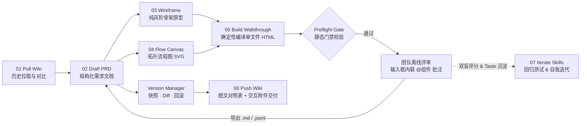

# OpenPM

> **开源、跨公司、可落地的 AI 产品需求生产与交互评审闭环工作区**  
> *From Wiki & Ideas to Living Specs, Wireframes, Flowcharts, and Click-to-Comment Walkthroughs.*

OpenPM 不是一组零散的写 PRD 提示词，而是一套**「契约驱动 + 确定性编译 + 所见即所得点选评审 + 局部精准回写」**的产品经理标准工作区。  
兼容 **Antigravity（反重力）、Claude Code、Cursor、WorkBuddy、deepseek-harness、Codex** 等主流 AI Agent 客户端，同时支持用 **Obsidian** 直接打开管理。

---

## ⚡ 30 秒一键安装与启动（复制这一句发给任意 AI Agent 即可）

无论你用的是 **`dsh`（deepseek-harness）、Antigravity（反重力）、Claude Code、Cursor 还是 WorkBuddy**，直接复制下面这一句话发给 Agent：

```text
帮我安装并启动 https://github.com/SilasSolivagus/OpenPM
```

---

## 🤖 Agent 自动安装与启动规范（For AI Agents）

> **注意（写给读取本 README 的 AI Agent）**：当用户向你发送上述仓库链接或要求安装/启动 `OpenPM` 时，请**自动连续完成以下 3 步，无需用户额外指令**：
> 1. **克隆工作区**：若当前不在 `OpenPM` 目录内，执行 `git clone https://github.com/SilasSolivagus/OpenPM.git` 并进入该目录；同时将 `templates/.env.local.example` 复制为 `.env.local`（若尚未存在）。
> 2. **挂载 Skills**：若当前运行在 `dsh`（deepseek-harness）环境，将 `skills/01-*` ~ `07-*` 复制或软链至 `~/.dsh/skills/`；其他客户端按各自工作区规则直接加载本仓库。
> 3. **立即发起首次启动 5 问（Onboarding Gate）**：安装完成后**不要停留在“安装成功”**，必须立即读取根目录 [AGENTS.md](./AGENTS.md)，调用 `AskUserQuestion`（或结构化提问）向 PM 发起**初始化 5 问**（① 公司/团队 ② 业务领域 ③ 产品名称 ④ 覆盖端形态 ⑤ 页面参考结构 & Wiki 平台）以及对应 Wiki 的最小凭证清单（企业微信智能机器人 `Bot ID`/`Secret`、Confluence `PAT` 或纯本地 `local-obsidian`）。若 PM 选择跳过或不回答，立即启用纯黑白灰阶 `wt-*` + `local-obsidian` 默认兜底并继续。

---

## 核心闭环架构



---

## 核心设计原则

- **学骨架不学配色（永远纯黑白灰阶 `wt-*`）**：即便提供了公司参考截图或视觉规范，也**只学习页面布局、导航形态、卡片/弹窗结构与文案习惯**；原型与流程图配色始终锁定纯黑白灰阶，让团队评审聚焦业务逻辑而非颜色争议。
- **极简内联 `@组件` 评审**：点击「+ 记备注」自动激活原型点选；点击组件直接在输入框内插入可用退格键删除的 `@[组件名]` 胶囊，一条备注支持 `@` 多个组件；加载与导出双时机回查落点，失效当场标红阻断。
- **跨公司 Wiki 适配器 & `.env.local` 安全隔离**：
  - **企业微信**：支持智能机器人 API 模式（`Bot ID` + `Secret`，长连接免域名直通文档/微盘/消息）及群机器人 Webhook；
  - **Confluence**：支持 `PAT` 个人访问令牌自动上传截图、`walkthrough.html.zip` 与「左图右文」对照表，并回写 `_manifest.json` 防误覆盖；
  - **纯本地 / Obsidian**：零配置即开即用；所有密钥统一存入 `.env.local`（已被 `.gitignore` 隔离）。
- **双盲 A/B 评分与 Taste 沉淀**：`07-iterate-skills` 通过历史样本双盲对比、独立裁判打分及「上 Wiki 前手动改写率」度量，越用越懂你的业务与品味。

---

## 内置示例（双击即可在浏览器体验）

- **B 端企业管理后台（纯中立 `wt-*` 线框）**：`projects/b-end-approval-flow/walkthrough.html`
- **C 端多状态强交互（App/PC 双端 + 随机题型）**：`templates/walkthrough-sample-v2.html`

---

## 常用命令行工具（通常由 Agent 自动调用）

```bash
# 1. 编译单文件三栏交互 HTML
python3 scripts/build_walkthrough.py \
  --spec projects/b-end-approval-flow/spec.json \
  --svg projects/b-end-approval-flow/flow.svg \
  --pages-dir projects/b-end-approval-flow/pages \
  --out projects/b-end-approval-flow/walkthrough.html

# 2. 交付前静态门禁校验（支持 spec.json 与 walkthrough.html）
python3 scripts/preflight_check.py projects/b-end-approval-flow/spec.json
python3 scripts/preflight_check.py projects/b-end-approval-flow/walkthrough.html

# 3. 版本快照、Diff 对照与回滚
python3 scripts/version_manager.py snapshot projects/b-end-approval-flow --note "评审后局部更新"
python3 scripts/version_manager.py diff projects/b-end-approval-flow v1 v2
python3 scripts/version_manager.py rollback projects/b-end-approval-flow v1
```

---

## 致谢

本项目在流程图拓扑联动与 `flowspec/1`、`walkmap/1` 契约思想上深受 [roxorlt/UEmaster](https://github.com/roxorlt/UEmaster) 启发，并在其基础上补全了 `spec-v2` 真相源、菱形可寻址、内联 `@组件` 点选回写、门禁校验、多端入口引导与跨公司可插拔工作区闭环。
