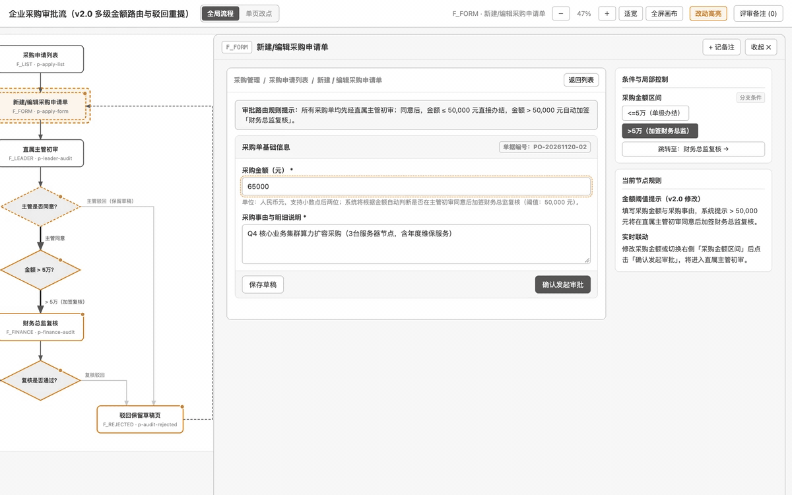
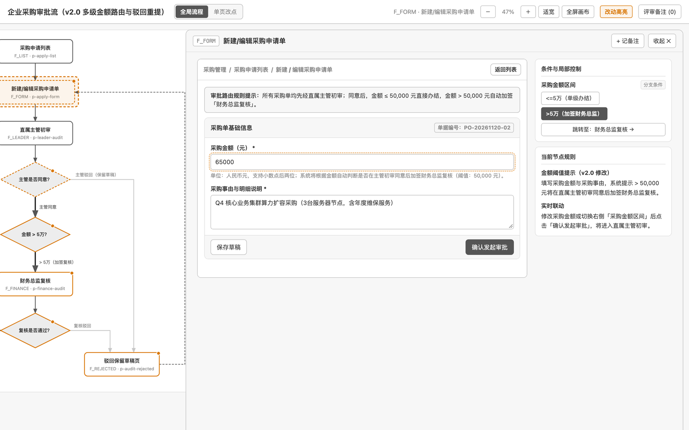
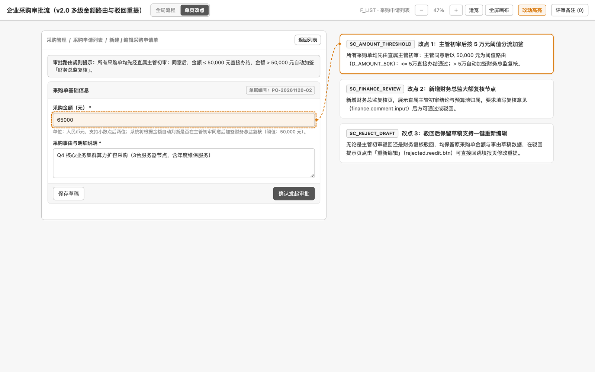
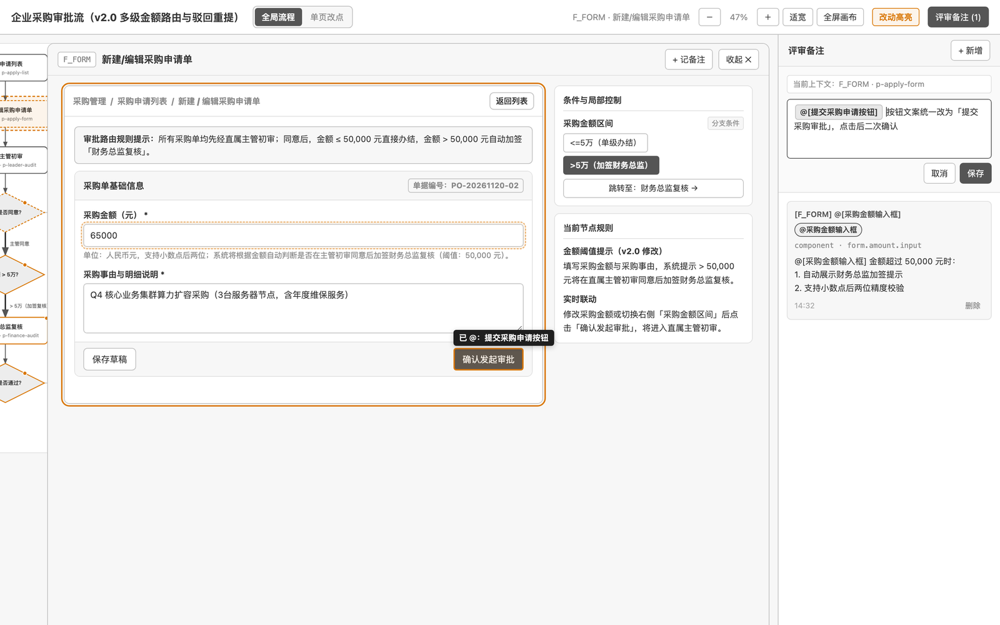
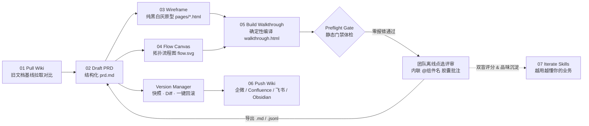

<div align="center">

# OpenPM

**把一句话想法，变成「可点选评审、可精准回写、可推企微/Wiki」的活原型工作台**

*开源、零第三方依赖、任何公司任何产品经理拿去即用的 AI 需求生产闭环*

[](./LICENSE)
[](#)
[](#)
[](#)
[](./AGENTS.md)

<p>
  <a href="https://silassolivagus.github.io/OpenPM/"><strong>🌐 免安装在线体验门户</strong></a> ·
  <a href="https://silassolivagus.github.io/OpenPM/projects/b-end-approval-flow/walkthrough.html"><strong>💼 B 端采购审批流 Demo</strong></a> ·
  <a href="https://silassolivagus.github.io/OpenPM/projects/demo-captcha-publish/walkthrough.html"><strong>📱 C 端双端安全验证 Demo</strong></a>
</p>



</div>

---

## 为什么不用普通提示词写 PRD？

大多数人用 AI 写需求，卡死在**「生成长篇废话 → 没法对着界面开评审会 → 让 AI 改一处结果把别的页面全改崩」**。OpenPM 用工程化契约彻底解决这 4 个痛点：

| 真实痛点 | 传统 AI 对话写需求 | OpenPM 标准工作台 |
| :--- | :--- | :--- |
| **研发看不清重点** | 几千字纯文字盲盒，存量功能与本期改动混成一锅粥 | **95% 纯黑白灰底图 + 5% 琥珀橙 `#D97706` 增量标引**，1 秒看清本期改了哪几个节点和控件 |
| **评审意见难对齐** | 会议室里口头指认“右上角第二个按钮下面那行字” | **开会点哪改哪**：点击界面控件自动插入 `@[提交采购申请按钮]` 胶囊，支持多行备注 |
| **AI 改稿越改越乱** | 改一句话重写整份文档，旧细节悄悄丢失 | **局部精准回写**：导出 `.md / .jsonl` 评审单喂回 AI，只改被 `@` 点名的章节与组件 |
| **交付脱节难归档** | 聊天记录散落在对话框，还要手工贴图搬去公司 Wiki | **单文件 HTML 离线双击即开**，定稿一句话自动组装「左图右文」推到**企业微信 / Confluence / 飞书 / Obsidian** |

---

## ⚡ 30 秒极速上手（小白零门槛）

### 第 1 步：复制这一句话发给你的 AI 工具

无论你用的是 **Antigravity（反重力）、Claude Code、Cursor、WorkBuddy 还是 `dsh`（deepseek-harness）**，不需要敲任何命令行，直接复制下面这句话发给它：

```text
帮我安装并启动 https://github.com/SilasSolivagus/OpenPM
```

> AI 会自动完成下载、问你 5 个基础业务背景问题（1 分钟答完，不答也能跑），帮你把密钥存进本机隔离文件，然后直接问你要做什么需求。

### 第 2 步：装好之后，日常只需要会说这 4 句大白话

| 你在什么阶段 | 直接对 AI 说这句大白话 | AI 在后台替你干什么 |
| :--- | :--- | :--- |
| **1. 做全新功能** | *“我要做一个【大文件上传断点续传】需求，先帮我出 PRD 和交互原型”* | 写结构化 `prd.md` → 画纯黑白灰原型 → 画拓扑流程图 → 自动做门禁体检 → 给你单文件 `walkthrough.html` |
| **2. 改线上老功能** | *“这是旧版 Wiki 链接/文档，本期要增加【超 5 万加签财务复核】”* | 先拉取旧文档做差异对比 → 用**琥珀橙 `#D97706`** 精准标出新增分支与改动控件 |
| **3. 开完评审会改稿** | *“这是刚才评审导出的 `review-feedback.md`，按里面的 `@组件` 备注改一下”* | 精准定位被 `@` 的控件与对应 PRD 段落做局部微调，绝不乱改其他页面，并自动存历史快照 |
| **4. 定稿发团队群/Wiki** | *“定稿了，帮我推到企业微信 / Confluence / 飞书”* | 自动打包「左图右文」对照表 + 交互 HTML 压缩包上传目标平台，并在群里发通知 |

---

## ✨ 三大核心交互亮点

### 1. 95% 纯黑白灰骨架 + 5% 琥珀橙增量高亮，三栏实时联动
左侧拓扑流程图（支持菱形条件分支点击切换）、中间高保真纯灰阶线框原型、右侧分支条件与节点规则实时同步；右上角一键开关**「改动高亮」**，存量背景退后，本期新增/修改的节点与控件一目了然：



### 2. 单页改点模式：需求规则卡与界面控件贝塞尔曲线直连
切换到顶部**「单页改点」**视图，点击右侧任意需求改点卡片，画布自动切到对应页面并用琥珀橙虚线直连目标输入框或按钮，研发再也不用猜“这条规则对应页面哪个字段”：



### 3. 原型点选 `@[组件名]` 胶囊批注，零损耗回写 AI
点击**「+ 记备注」**后直接点选原型上的任意按钮、输入框或弹窗，自动向输入框插入 `@[组件名]` 胶囊（`Backspace` 一键整颗删除，支持换行分条与多组件同时 `@`），评审结束一键导出 `.md` 或 `.jsonl` 喂回 AI：



---

## 核心闭环架构



---

<details>
<summary><strong>🤖 Agent 自动安装与启动规范（写给 AI Agent 读取，人类用户无需展开）</strong></summary>

<br/>

> **注意（写给读取本 README 的 AI Agent）**：当用户向你发送上述仓库链接或要求安装/启动 `OpenPM` 时，请**静默完成安装并严格按以下流程交互，严禁输出冗长的工程安装报告、PID 或自动启动无关示例项目的本地服务**：
> 1. **静默克隆与挂载**：克隆本仓库，复制 `templates/.env.local.example` 为 `.env.local`（若不存在）；若在 `dsh` 环境，将 `skills/01-*` ~ `07-*` 软链至 `~/.dsh/skills/`。
> 2. **执行两步交互配置（详见 [AGENTS.md](./AGENTS.md)）**：
>    - 先调用 `AskUserQuestion` 发起基础 5 问（公司/业务/产品/端形态/参考与 Wiki 平台）；
>    - 若 PM 选择了企业微信（`wecom`）、`confluence` 或飞书（`feishu`），**必须立即开口向 PM 索要 `Bot ID` + `Secret`、`CONFLUENCE_PAT` 或 `FEISHU_APP_ID` + `FEISHU_APP_SECRET`，拿到后由你直接代写入本地 `.env.local`**，严禁甩锅让 PM 自己去手动改文件！（若 PM 选择暂不提供或跳过，则启用本地离线兜底）。
> 3. **极简收口并进入首个需求（最多 8 行）**：
>    - 用两句话向 PM 交代清楚 **「东西在本地放哪（`projects/<产品名>/` 与 `.env.local`）、什么时候才会往远端传（仅定稿执行 `06-push-wiki` 时）」**；
>    - 立即开口问 PM：**“现在一切就绪！请告诉我你要做的第一个需求是什么？”**，直接进入 `01-pull-wiki` 或 `02-draft-prd` 环节。

</details>

<details>
<summary><strong>🛠️ 底层目录结构与命令行工具参考（通常由 AI 自动调用，无需手敲）</strong></summary>

<br/>

### 仓库核心目录
- `AGENTS.md` / `CLAUDE.md` / `WORKBUDDY.md` / `.cursorrules`：跨客户端统一智能体行为与交互规范
- `skills/01-*` ~ `07-*`：从拉取旧文档、写 PRD、画灰阶线框、画拓扑图、编译走查台到推送 Wiki 与自我迭代的 6+1 标准技能包
- `specs/`：`spec-v2` JSON Schema、组件锚点契约、正交流程图规范与静态门禁清单
- `adapters/`：企业微信（`wecom`）、Confluence（`confluence`）、飞书（`feishu`）与本地 Obsidian（`local-obsidian`）交付适配器
- `projects/`：各产品需求独立工作区（内置 `b-end-approval-flow` 与 `demo-captcha-publish` 两个完整可运行样板）

### 常用脚本命令
```bash
# 1. 交付前静态门禁校验（先校验 spec.json，编译后再校验 walkthrough.html）
python3 scripts/preflight_check.py projects/b-end-approval-flow/spec.json

# 2. 编译单文件三栏交互 HTML（可选 --skeleton-css 仅微调圆角/间距/字号）
python3 scripts/build_walkthrough.py \
  --spec projects/b-end-approval-flow/spec.json \
  --svg projects/b-end-approval-flow/flow.svg \
  --pages-dir projects/b-end-approval-flow/pages \
  --out projects/b-end-approval-flow/walkthrough.html

python3 scripts/preflight_check.py projects/b-end-approval-flow/walkthrough.html

# 3. Wiki 拉取与图文对照推送
python3 scripts/wiki_sync.py pull projects/b-end-approval-flow
python3 scripts/wiki_sync.py push projects/b-end-approval-flow

# 4. 版本快照、Diff 对照与回滚
python3 scripts/version_manager.py snapshot projects/b-end-approval-flow --note "评审后局部更新"
python3 scripts/version_manager.py diff projects/b-end-approval-flow v1 v2
python3 scripts/version_manager.py rollback projects/b-end-approval-flow v1
```

</details>

---

## 开源许可与致谢

- 本项目基于 [MIT License](./LICENSE) 开源（Copyright © 2026 SilasSolivagus）。
- 本项目在流程图拓扑联动与契约思想上深受 [roxorlt/UEmaster](https://github.com/roxorlt/UEmaster) 启发，并在其基础上补全了 `spec-v2` 真相源、95% 灰阶 + 5% 琥珀橙增量标引、菱形分支可寻址、内联 `@组件` 胶囊回写、静态门禁校验、多端入口引导与跨公司 Wiki 交付闭环。
