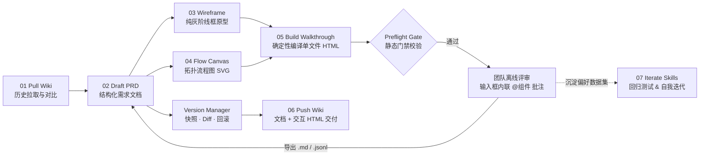

# OpenPM

> **开源、跨公司、可落地的 AI 产品需求生产与交互评审闭环工作区**  
> *From Wiki & Ideas to Living Specs, Wireframes, Flowcharts, and Click-to-Comment Walkthroughs.*

OpenPM 不是一组零散的写 PRD 提示词，而是一套**「契约驱动 + 确定性编译 + 所见即所得点选评审 + 局部精准回写」**的产品经理标准工作区。  
任何公司的任何产品经理，只需把这个目录作为本地工作区（推荐用 **Obsidian** 直接作为 Vault 打开），即可跑通从需求拉取、原型绘制、交互走查、团队评审到版本回滚的全流程。

---

## 为什么做 OpenPM？

传统的 AI 写 PRD 存在三个断层：
1. **盲盒生成、换公司就废**：Prompt 绑死某家公司的内网 Wiki 和业务术语，换个端或换个团队就水土不服。
2. **评审只能口头指认**：导出的原型只是静态图，评审时说“把那个滑块改宽点”，下游 Agent 根本不知道指哪页哪个组件。
3. **改一处全量飘**：评审后让 AI 改稿，往往把整份 PRD 和所有页面全量重写，原本确认好的细节被改坏。

**OpenPM 的解法**：把“生成”和“编译”拆开——**PRD 与原型页面走规范与门禁校验，三栏交互工作台走确定性编译，评审意见通过内联 `@组件` 精确回写。**

---

## 核心闭环架构



---

## 核心亮点

- **零依赖单文件交互交付**：`build_walkthrough.py` 编译出的 `walkthrough.html` 不依赖任何 CDN 或后端服务，发到群里双击浏览器即可打开走查（支持流程图拖拽/双指缩放、菱形判断节点点击、PC/App 双端变量切换、单页改点连线）。
- **极简内联 `@组件` 评审**：点击「+ 记备注」后自动进入原型捕获点选态；点击原型组件直接在输入框内插入可用退格键删除的 `@[组件名]` 胶囊，一条备注支持 `@` 多个组件；加载与导出双时机回查落点，失效当场标红阻断。
- **纯黑白灰阶线框兜底**：默认遵循克制的黑白灰阶 `wt-*` 线框规范，不让花哨配色分散评审注意力；同时支持通过 `references/` 截图或 `--theme theme.css` 注入公司专属设计规范。
- **可插拔 Wiki 适配器**：内置 `local-obsidian`（默认零依赖）、`feishu`、`confluence` 适配规范，无外网权限也能纯本地闭环。
- **确定性门禁与版本安全网**：`preflight_check.py` 校验 `spec.json` 与 `walkthrough.html` 的拓扑完整性、菱形可点击性与组件锚点覆盖；`version_manager.py` 支持快照、Diff 与一键回滚。

---

## 3 分钟快速上手

### 方式一：用 Obsidian 打开（推荐）
1. 打开 **Obsidian** → `Open folder as vault` → 选择本仓库根目录 `OpenPM`。
2. 复制模板创建你的第一个需求项目：
   ```bash
   cp templates/project-context.template.md projects/my-feature/project-context.md
   ```
3. 在 `project-context.md` 中填写 3 项最小信息：**端形态**（如 `web-admin` / `ios-app`）、**需求来源**（Wiki 或本地文档）、**设计参考**（可选，放截图到 `references/` 或留空使用默认灰阶线框）。
4. 对你的 AI Agent 下达指令：
   > “读取 `projects/my-feature/project-context.md`，按 `skills/01` 到 `05` 流程生成 PRD 与 `walkthrough.html`。”

### 方式二：直接体验内置完整示例
仓库内已附带两个开箱即用的端到端示例：
- **B 端企业管理后台（纯中立 `wt-*` 线框）**：直接用浏览器打开 `projects/b-end-approval-flow/walkthrough.html`
- **C 端多状态强交互（App/PC 双端 + 随机题型）**：直接用浏览器打开 `templates/walkthrough-sample-v2.html`

---

## 常用命令行工具

```bash
# 1. 将 spec.json + flow.svg + pages/ 编译为单文件三栏交互 HTML
python3 scripts/build_walkthrough.py \
  --spec projects/b-end-approval-flow/spec.json \
  --svg projects/b-end-approval-flow/flow.svg \
  --pages-dir projects/b-end-approval-flow/pages \
  --out projects/b-end-approval-flow/walkthrough.html

# （可选）注入公司自定义主题 CSS
python3 scripts/build_walkthrough.py --spec ... --svg ... --pages-dir ... --theme theme.css --out walkthrough.html

# 2. 运行交付前静态门禁（支持校验 spec.json 与 walkthrough.html）
python3 scripts/preflight_check.py projects/b-end-approval-flow/spec.json
python3 scripts/preflight_check.py projects/b-end-approval-flow/walkthrough.html

# 3. 版本快照、Diff 对照与回滚
python3 scripts/version_manager.py snapshot projects/b-end-approval-flow --note "评审后局部更新"
python3 scripts/version_manager.py diff projects/b-end-approval-flow v1 v2
python3 scripts/version_manager.py rollback projects/b-end-approval-flow v1
```

---

## 目录结构

```text
OpenPM/
├── README.md
├── adapters/                  # Wiki 适配器协议（local-obsidian / feishu / confluence）
├── specs/                     # 核心契约（spec-v2 Schema / 落点 Schema / 拓扑规范 / 门禁清单）
├── skills/                    # 01~07 全套标准化 Skill 定义
│   ├── 01-pull-wiki/
│   ├── 02-draft-prd/
│   ├── 03-prd-to-wireframe-prototype/
│   ├── 04-flow-canvas/
│   ├── 05-flow-walkthrough/
│   ├── 06-push-wiki/
│   └── 07-iterate-skills/
├── scripts/                   # 确定性编译器、静态门禁与版本管理脚本
├── templates/                 # project-context 模板与交互工作台样板
├── evals/                     # 回归测试用例与人机决策数据集（业务改点 vs Skill 缺陷）
└── projects/                  # 具体需求项目工作区（含 b-end-approval-flow 与 demo-captcha-publish）
```

---

## 致谢

本项目在流程图拓扑联动与 `flowspec/1`、`walkmap/1` 契约思想上深受 [roxorlt/UEmaster](https://github.com/roxorlt/UEmaster) 启发，并在其基础上补全了 `spec-v2` 真相源、菱形可寻址、内联 `@组件` 点选回写、门禁校验与跨公司可插拔工作区闭环。
