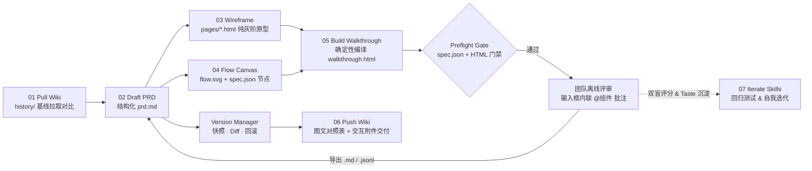

# OpenPM

> **开源、跨公司、可落地的 AI 产品需求生产与交互评审闭环工作区**  
> *From Wiki & Ideas to Living Specs, Wireframes, Flowcharts, and Click-to-Comment Walkthroughs.*

OpenPM 不是一组零散的写 PRD 提示词，而是一套**「契约驱动 + 确定性编译 + 所见即所得点选评审 + 局部精准回写」**的产品经理标准工作区。  
兼容 **Antigravity（反重力）、Claude Code、Cursor、WorkBuddy、deepseek-harness、Codex** 等主流 AI Agent 客户端，同时支持用 **Obsidian** 直接打开管理。

---

## ⚡ 30 秒一键安装与启动（复制这一句发给任意 AI Agent 即可）

无论你用的是 **`dsh`（deepseek-harness）、Antigravity（反重力）、Claude Code、Cursor 还是 WorkBuddy**，直接复制下面这一句话发给 Agent：

```text
帮我安装并启动 https://github.com/SilasSolivagus/OpenPM
```

---

## 🤖 Agent 自动安装与启动规范（For AI Agents）

> **注意（写给读取本 README 的 AI Agent）**：当用户向你发送上述仓库链接或要求安装/启动 `OpenPM` 时，请**静默完成安装并严格按以下流程交互，严禁输出冗长的工程安装报告、PID 或自动启动无关示例项目的本地服务**：
> 1. **静默克隆与挂载**：克隆本仓库，复制 `templates/.env.local.example` 为 `.env.local`（若不存在）；若在 `dsh` 环境，将 `skills/01-*` ~ `07-*` 软链至 `~/.dsh/skills/`。
> 2. **执行两步交互配置（见 [AGENTS.md](./AGENTS.md)）**：
>    - 先调用 `AskUserQuestion` 发起基础 5 问（公司/业务/产品/端形态/参考与 Wiki 平台）；
>    - 若 PM 选择了企业微信（`wecom`）、`confluence` 或飞书（`feishu`），**必须立即开口向 PM 索要 `Bot ID` + `Secret`、`CONFLUENCE_PAT` 或 `FEISHU_APP_ID` + `FEISHU_APP_SECRET`，拿到后由你直接代写入本地 `.env.local`**，严禁甩锅让 PM 自己去手动改文件！（若 PM 选择暂不提供或跳过，则启用本地离线兜底）。
> 3. **极简收口并进入首个需求（最多 8 行）**：
>    - 用两句话向 PM 交代清楚 **「东西在本地放哪（`projects/<产品名>/` 与 `.env.local`）、什么时候才会往远端传（仅定稿执行 `06-push-wiki` 时）」**；
>    - 立即开口问 PM：**“现在一切就绪！请告诉我你要做的第一个需求是什么？”**，直接进入 `01-pull-wiki` 或 `02-draft-prd` 环节。

---

## 核心闭环架构



---

## 核心设计原则

- **95% 纯黑白灰底图 + 5% 唯一琥珀橙 `#D97706` 工程标引色（学骨架不学配色）**：
  - 即使提供了公司参考截图或规范，也**只学习页面间距、圆角、导航形态、卡片/弹窗结构与文案习惯**（如需注入骨架微调，仅限 `--skeleton-css` 调整圆角/间距/字号）；
  - 所有存量背景与业务组件（含主次按钮、弹窗、驳回/错误态）一律 **100% 纯黑白灰阶 `wt-*`**，严禁品牌蓝、成功绿、危险红等业务语义色；
  - 全系统唯一工程标引色 **琥珀橙 `#D97706`** 严格仅限客观的 **① 本期改动增量（Delta：`SPEC_CARDS` 锚点组件与 `change: "new"|"modified"` 流程节点）** 与 **② 当前走查/点选焦点（Focus）**，让团队一眼看清“改了哪、正在看哪”。
- **极简内联 `@[组件名]` 评审**：点击「+ 记备注」自动激活原型点选；点击组件直接在输入框内插入可用 `Backspace` 退格键一键删除的 `@[组件名]` 胶囊，一条备注支持 `@` 多个组件；加载与导出双时机回查 `DOC_VERSION_HASH` 与 `targets` 落点，失效当场拦截。
- **跨公司 Wiki 适配器 & `.env.local` 安全隔离**：
  - **企业微信（`wecom`）**：支持智能机器人 API 模式（`Bot ID` + `Secret`，免域名直通文档/微盘/消息）及群机器人 Webhook；
  - **Confluence（`confluence`）& 飞书（`feishu`）**：通过 `scripts/wiki_sync.py` 统一交付「左图右文」对照表、页面截图与 `walkthrough.html.zip`，并回写 `_manifest.json` 防多人覆盖；
  - **纯本地 / Obsidian（`local-obsidian`）**：零配置即开即用；所有密钥统一由 Agent 代写入 `.env.local`（已被 `.gitignore` 隔离）。
- **双盲 A/B 评分与 Taste 沉淀**：`07-iterate-skills` 通过历史样本双盲对比、独立裁判打分及「上 Wiki 前手动改写率」度量，越用越懂你的业务与品味。

---

## 内置示例（双击即可在浏览器体验）

- **B 端企业管理后台（纯黑白灰 `wt-*` 底图 + `#D97706` 增量标引）**：`projects/b-end-approval-flow/walkthrough.html`
- **C 端多状态强交互（App/PC 双端 + 随机题型）**：`templates/walkthrough-sample-v2.html`

---

## 常用命令行工具（通常由 Agent 自动调用）

```bash
# 1. 交付前静态门禁校验（先校验 spec.json，编译后再校验 walkthrough.html）
python3 scripts/preflight_check.py projects/b-end-approval-flow/spec.json

# 2. 编译单文件三栏交互 HTML（可选 --skeleton-css 仅微调圆角/间距/字号）
python3 scripts/build_walkthrough.py \
  --spec projects/b-end-approval-flow/spec.json \
  --svg projects/b-end-approval-flow/flow.svg \
  --pages-dir projects/b-end-approval-flow/pages \
  --out projects/b-end-approval-flow/walkthrough.html

python3 scripts/preflight_check.py projects/b-end-approval-flow/walkthrough.html

# 3. Wiki 拉取与图文对照推送
python3 scripts/wiki_sync.py pull projects/b-end-approval-flow
python3 scripts/wiki_sync.py push projects/b-end-approval-flow

# 4. 版本快照、Diff 对照与回滚
python3 scripts/version_manager.py snapshot projects/b-end-approval-flow --note "评审后局部更新"
python3 scripts/version_manager.py diff projects/b-end-approval-flow v1 v2
python3 scripts/version_manager.py rollback projects/b-end-approval-flow v1
```

---

## 开源许可与致谢

- 本项目基于 [MIT License](./LICENSE) 开源（Copyright (c) 2026 SilasSolivagus）。
- 本项目在流程图拓扑联动与契约思想上深受 [roxorlt/UEmaster](https://github.com/roxorlt/UEmaster) 启发，并在其基础上补全了 `spec-v2` 真相源、菱形可寻址、内联 `@组件` 点选回写、门禁校验、多端入口引导与跨公司可插拔工作区闭环。
