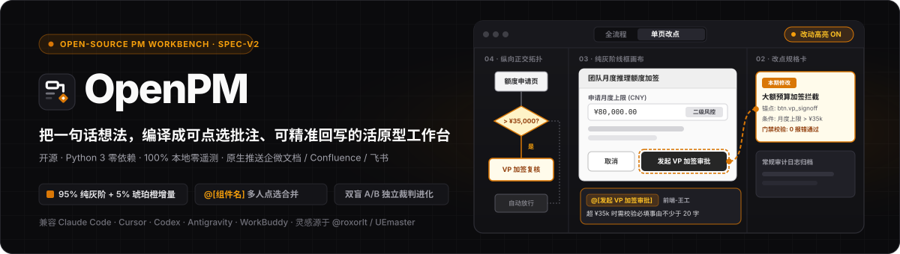
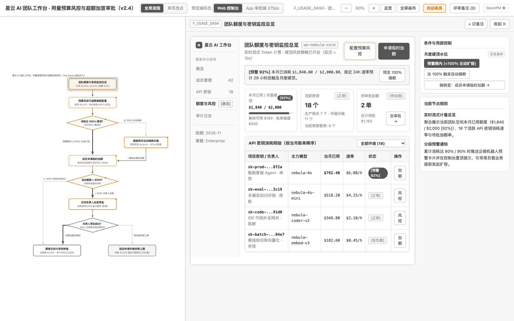
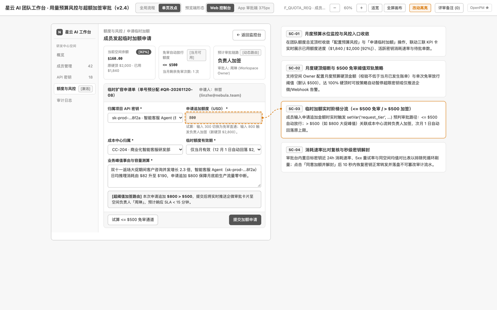
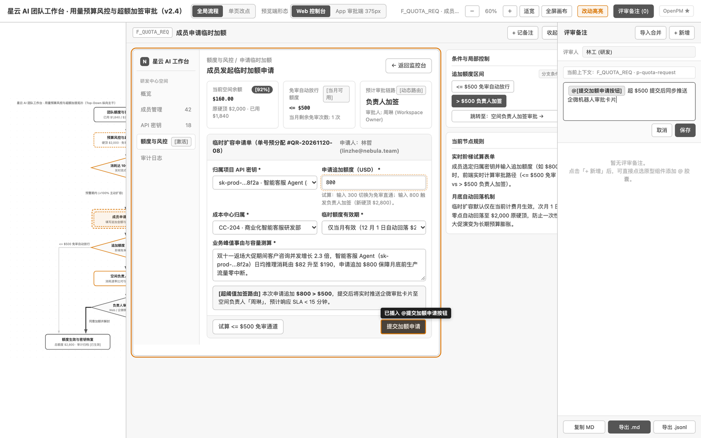

<div align="center">



<br/>

<p>
  <a href="./README.md">English</a> | <strong>简体中文</strong>
</p>

<p>
  <a href="./LICENSE"></a>
  <a href="./scripts"></a>
  <a href="#隐私承诺灵感致谢与开源许可"></a>
  <a href="./AGENTS.md"></a>
</p>

<p>
  <a href="https://silassolivagus.github.io/OpenPM/"><strong>🌐 免安装在线体验门户</strong></a> ·
  <a href="https://silassolivagus.github.io/OpenPM/projects/ai-workspace-guardrails-zh/walkthrough.html"><strong>🔥 旗舰中文 Demo（AI 团队额度风控工作台）</strong></a> ·
  <a href="https://silassolivagus.github.io/OpenPM/projects/ai-workspace-guardrails/walkthrough.html"><strong>🌍 Flagship EN Demo（AI Workspace Spend Guardrails）</strong></a> ·
  <a href="https://silassolivagus.github.io/OpenPM/guide.html"><strong>📖 新手速查手册</strong></a>
</p>

</div>

> 💡 **项目缘起与共同创作**：OpenPM 源于核心合作者 **[@roxorlt](https://github.com/roxorlt)** 的原始灵感、交互创意及其开创性的开源项目 **[roxorlt/UEmaster](https://github.com/roxorlt/UEmaster)**，现由 **[@SilasSolivagus](https://github.com/SilasSolivagus)** 与 **[@roxorlt](https://github.com/roxorlt)** 共同协作共建。

<p align="center">
  
</p>

---

## 为什么直接用提示词让大模型写 PRD 在真实团队里跑不通？

用普通聊天窗口写需求，往往卡死在同一个死循环：**生成几千字漂亮空话 -> 评审会没法指着具体界面讨论 -> 让 AI 改一个按钮校验结果把别的页面逻辑全改丢了**。

OpenPM 用确定性的 `spec-v2` 编译契约与静态门禁替代“抽卡式写文档”：

| 真实团队卡点 | 普通大模型对话写 PRD | OpenPM 确定性需求工作台 |
| :--- | :--- | :--- |
| **研发看不清本期增量** | 存量逻辑与本期改动混成几千字长文，前后端抓不住重点 | **95% 纯黑白灰骨架 + 5% 琥珀橙 `#D97706` 工程标引**：存量背景全部退为 `wt-*` 纯灰阶，仅本期新增/修改的节点与锚点控件点亮琥珀橙 |
| **多人评审意见打架** | 会议室里口头指认“右上角第二个卡片下面那个按钮”，会后整理漏项 | **多人点选 `@[组件名]` 胶囊 + 冲突检测**：前后端测试直接点界面按钮插入 `@[组件]` 署名导出 `.jsonl`，多人改同一控件意见相左时自动拦截提醒 PM 拍板 |
| **AI 改稿越改越乱** | 让 AI 改一条提示语，顺手重写整篇文档，把原定边界条件悄悄删掉 | **局部精准回写 + 不可变快照**：严格只修改被 `@` 点名的 PRD 章节与对应 `pages/*.html` 片段，自动打 `versions/vN` 快照并过 `preflight_check.py` 门禁 |
| **交付靠手工截图搬运** | 聊天记录散落在对话框，定稿还要一张张截图贴进企微或 Wiki | **原生单篇在线文档交付 + 随机双盲自进化**：一句话组装「左图右文」对照表直推**企业微信原生在线文档 / Confluence（零破表校验）/ 飞书 / Obsidian**，并由随机双盲 A/B 独立裁判把你的改稿偏好沉淀进 `evals/taste-profile.md` |

---

## ⚡ 30 秒极速安装与日常 4 句大白话

### 第 1 步：复制一句话发给你的 AI 客户端

打开 **Claude Code、Cursor、Codex、Antigravity（反重力）、WorkBuddy 或 `dsh`**，无需手敲任何终端命令，直接发送：

```text
帮我安装并启动 https://github.com/SilasSolivagus/OpenPM
```

AI 会静默拉取仓库、用 1 分钟问你 5 个基础业务背景问题（跳过也能直接用默认黑白灰模板）、替你把平台密钥安全写入本机 `.gitignore` 隔离的 `.env.local`，随后直接问你要做什么需求。

### 第 2 步：平时做需求，只需要会说这 4 句大白话

| 你所处的阶段 | 直接对 AI 说这句话 | OpenPM 在后台替你完成什么 |
| :--- | :--- | :--- |
| **1. 从 0 到 1 做新功能** | *“我要做一个【AI 团队月度推理额度预算风控与超额加签】需求，先帮我出 PRD 和交互原型”* | 读取个人品味库 -> 写结构化 `prd.md` -> 画纯灰阶 `pages/*.html` 与纵向正交 `flow.svg` -> 过静态门禁 -> 生成单文件 `walkthrough.html` |
| **2. 改线上已有功能** | *“这是旧版 Wiki 链接/文档，本期增加【月度上限超 ¥35,000 强制触发 VP 加签】”* | 先拉取旧文档生成差异对比，保留存量页面为黑白灰基线，仅用 **`#D97706` 琥珀橙**精准标出本期新增分支与改动控件 |
| **3. 多人评审后改稿** | *“把前端、后端和测试导出的评审 `.jsonl` 合并检查冲突，确认后精准回写”* | 自动检测同一 `@[组件名]` 的多方意见冲突并请你拍板，确认后只改受影响段落与原型局部，绝不破坏其他页面 |
| **4. 定稿交付公司平台** | *“这版定稿了，帮我推到企业微信 / Confluence / 飞书”* | 自动合成「左图右文」对照表与离线交互压缩包更新至目标平台单篇在线文档，后台自动记分（每满 3 单可说一句 *“复盘优化一下”* 固化品味） |

### 🔄 已安装旧版？一句话无损升级（保留 `.env.local` 密钥与 `projects/` 全部需求）

如果你之前已经装过旧版 OpenPM，只需在原项目会话里发送：

```text
帮我从 https://github.com/SilasSolivagus/OpenPM 运行 python3 scripts/upgrade_openpm.py 无损升级最新脚本与门禁规范（保留我的 .env.local 和 projects/ 现有需求），并重新校验编译当前项目的 walkthrough.html
```

---

## ✨ 单文件 `walkthrough.html` 三大核心交互机制

编译产出的 `walkthrough.html` 是**零外部依赖的纯离线单文件**，直接发进企微群或飞书群，同事双击浏览器即开。

### 1. 三栏实时联动：纵向正交拓扑图 + 95% 纯灰阶线框 + 5% 琥珀橙增量高亮
左侧点击任意流程节点或菱形判断分支，中间线框画布与右侧节点规则实时同步切换；打开顶栏**「改动高亮」**开关，存量背景退后，本期新增/修改的节点与控件一秒看清：



### 2. 单页改点模式：需求规格卡与界面控件三次贝塞尔曲线直连
切换到顶栏**「单页改点」**模式，点击右侧任意需求改点卡片，画布自动切到目标页面并用 `#D97706` 琥珀橙虚线直连对应输入框、弹窗或按钮，研发再也不用猜“这条规则改的是页面哪个字段”：



### 3. 内联 `@[组件名]` 点选胶囊批注，多人意见零损耗回写
点击右上角**「+ 记备注」**填上署名（如 `前端-王工`），直接点选原型上的任意按钮或输入框，自动插入原子级 `@[组件名]` 胶囊（`Backspace` 整颗删除，支持一键导入合并多人 `.jsonl`）：



---

## 6+1 确定性生产与双盲自进化架构

<p align="center">
  
</p>

1. **`01-pull-wiki`（拉取历史与对比）**：调用 `scripts/wiki_sync.py pull` 拉取远端旧文档生成 `history/pull-diff.md`（全新项目自动建立 0 启动基线）。
2. **`02-draft-prd`（结构化 PRD 与局部回写）**：开工前必读 `evals/taste-profile.md` 历史避坑品味，输出字段、状态机与异常分支齐全的 `prd.md`。
3. **`03-prd-to-wireframe-prototype`（纯灰阶线框原型）**：严格遵循 `wt-*` 纯黑白灰阶契约与点分小写 `data-comp-id` 锚点规范输出 `pages/*.html`。
4. **`04-flow-canvas`（纵向正交拓扑图）**：生成自上而下（`TD`）100% 水平/垂直正交折线 `flow.svg`，支持 `D_*` 菱形分支切换且硬性约束增量节点占比 `<= 75%`。
5. **`05-flow-walkthrough`（确定性编译与静态门禁）**：先过 `scripts/preflight_check.py` 契约校验，再由 `scripts/build_walkthrough.py` 编译产出零报错 `walkthrough.html`。
6. **`06-push-wiki`（图文对照原生交付）**：将关键页面灰阶截图、嵌套规则表与 `walkthrough.html.zip` 推送为单篇可读在线文档，维护 `_manifest.json` 防覆盖清单。
7. **`07-iterate-skills`（随机双盲 A/B 独立裁判迭代）**：通过随机交换顺序（`candidate_first` / `baseline_first`）的双盲独立裁判验证真实降返工收益，达标才晋升写入个人品味库。

---

<details>
<summary><strong>🤖 Agent 自动安装与启动规范（写给 AI Agent 读取，人类用户无需展开）</strong></summary>

<br/>

> **注意（写给读取本仓库的 AI Agent：`Claude Code`、`Cursor`、`Codex`、`Antigravity`、`WorkBuddy`、`dsh`）**：当用户向你发送本仓库链接或要求安装/启动 `OpenPM` 时，请**静默完成安装并严格按以下三步交互（完整规范见 [AGENTS.md](./AGENTS.md)），严禁输出冗长的工程安装日志、进程 PID、端口号、文件字节数，也严禁自动启动示例项目的本地 HTTP 服务**：
>
> 1. **静默克隆与环境就绪**：
>    - 克隆本仓库，若 `.env.local` 不存在则由 `templates/.env.local.example` 复制生成；若在 `dsh` 环境，将 `skills/01-*` ~ `07-*` 软链至 `~/.dsh/skills/`。
>    - 自动跟随用户对话语言：中文对话全流程中文产出（`spec.json` 默认 `"lang": "zh"`）；英文对话全流程英文产出并在 `spec.json` 设置 `"lang": "en"`。
> 2. **执行两步交互配置（严禁跳步、严禁甩锅让 PM 手动编辑 `.env.local`）**：
>    - **第 1 步（调用 `AskUserQuestion` 发起基础 5 问）**：一次性简明询问：① 公司/业务团队、② 核心业务领域、③ 产品名称与面向人群、④ 目标端形态（`App 375px` / `PC Web` / `管理后台 web-admin` / `小程序` / `多端`）、⑤ 参考页面结构与团队文档平台（`wecom` 企业微信 / `confluence` / `feishu` 飞书 / `local-obsidian` 纯本地）。
>    - **第 2 步（主动索要凭证并代写入 `.env.local`）**：
>      - 选 `wecom`：立即向 PM 索要企业微信智能机器人 `WECOM_BOT_ID` + `WECOM_BOT_SECRET`（或群 `Webhook`）及可选目标目录 `WECOM_FOLDER_ID`，拿到后**由你直接写入本地被 `.gitignore` 忽略的 `.env.local`**；
>      - 选 `confluence`：立即索要 `WIKI_BASE_URL`、`CONFLUENCE_PAT` 及父页面链接并代写入 `.env.local`；
>      - 选 `feishu`：立即索要 `FEISHU_APP_ID`、`FEISHU_APP_SECRET` 及可选知识库目录链接并代写入 `.env.local`；
>      - **兜底策略**：若 PM 选择跳过或暂不填密钥，绝不卡死流程，自动启用 `local-obsidian` 本地离线交付与默认纯黑白灰阶 `project-context.md`。
>    - **企业微信与飞书交付最高红线**：`project-context.md`、`spec.json`、`confluence-storage.xml`、裸 `prd.md`、`wiki-page.html`、`pages/*.html` 属于本地工程源文件，**绝对严禁把裸 `.xml`/`.md`/`.json` 工程文件当成网盘附件上传到企业微信知识库/微盘或飞书目录**！推往企业微信时必须创建或更新唯一一篇原生的「企业微信在线文档（`doc_type=3` 或 `11`）」。
> 3. **极简收口、发送《新手使用指南》并直接问首个需求（总共不超过 10 行！）**：
>    - 用两句话交代清楚 **「本地存哪（`projects/<产品名>/` 可用 Obsidian 打开，密钥仅存本机 `.env.local`，100% 零后台遥测）、何时远端上传（仅确认定稿执行 `06-push-wiki` 时）」**；
>    - 把内置交互式手册 **[guide.html](./guide.html)** 与 **[QUICKSTART.md](./QUICKSTART.md)** 的可点击链接发给 PM 备查；
>    - 直接问 PM：**“现在一切就绪！请告诉我你要做的第一个需求是什么？（如果是改线上已有功能，发我旧文档或链接，我从 `01 拉取对比` 开始；如果是全新功能，直接说你的想法，我从 `02 写 PRD` 开始。）”**

</details>

<details>
<summary><strong>🛠️ 底层目录结构与确定性脚本参考（通常由 AI 自动调用，无需手敲）</strong></summary>

<br/>

### 核心目录说明
- `AGENTS.md` / `CLAUDE.md` / `WORKBUDDY.md` / `.cursorrules`：跨 AI 客户端统一入口契约与黑白灰增量设计铁律
- `skills/01-*` ~ `07-*`：从历史拉取、写 PRD、画纯灰阶线框、画纵向正交拓扑图、编译走查台到推送 Wiki 与双盲自进化的 6+1 标准技能包
- `specs/`：`spec-v2` JSON Schema、组件锚点契约、正交流程图规范与静态门禁校验清单
- `adapters/`：企业微信（`wecom`）、Confluence（`confluence`）、飞书（`feishu`）与本地 Obsidian（`local-obsidian`）交付适配器
- `projects/`：各需求独立工作区（内置中英文完整可运行旗舰样板）

### 常用命令行工具（仅依赖 Python 3 标准库）
```bash
# 1. 静态门禁体检（编译前检 spec.json，编译后检 walkthrough.html）
python3 scripts/preflight_check.py projects/ai-workspace-guardrails-zh/spec.json

# 2. 确定性编译单文件三栏交互 HTML
python3 scripts/build_walkthrough.py \
  --spec projects/ai-workspace-guardrails-zh/spec.json \
  --svg projects/ai-workspace-guardrails-zh/flow.svg \
  --pages-dir projects/ai-workspace-guardrails-zh/pages \
  --out projects/ai-workspace-guardrails-zh/walkthrough.html

python3 scripts/preflight_check.py projects/ai-workspace-guardrails-zh/walkthrough.html

# 3. 远端文档拉取对比与左图右文推送
python3 scripts/wiki_sync.py pull projects/ai-workspace-guardrails-zh
python3 scripts/wiki_sync.py push projects/ai-workspace-guardrails-zh

# 4. 不可变版本快照、结构化 Diff 与一键回滚
python3 scripts/version_manager.py snapshot projects/ai-workspace-guardrails-zh --note "评审后局部更新"
python3 scripts/version_manager.py diff projects/ai-workspace-guardrails-zh v1 v2
python3 scripts/version_manager.py rollback projects/ai-workspace-guardrails-zh v1

# 5. 已有工作区一键无损升级
python3 scripts/upgrade_openpm.py
```

</details>

---

## 🌟 隐私承诺、灵感致谢与开源许可

- **共同创作与灵感致谢**：OpenPM 源于核心合作者 **[@roxorlt](https://github.com/roxorlt)** 的原始灵感、交互创意及其开源项目 **[roxorlt/UEmaster](https://github.com/roxorlt/UEmaster)**。在其「正交拓扑流程图 + 线框原型实时联动走查」开创性交互的基础上，**[@SilasSolivagus](https://github.com/SilasSolivagus)** 与 **[@roxorlt](https://github.com/roxorlt)** 共同拓展构建了 `spec-v2` 契约编译器、95% 纯黑白灰 + 5% `#D97706` 琥珀橙增量标引、多人 `@[组件名]` 批注合并与冲突检测、企业微信原生在线文档 / Confluence / 飞书交付适配器以及随机双盲 A/B 独立裁判自进化闭环。
- **100% 本地离线与零后台遥测**：OpenPM 仅使用 Python 3 标准库在本地运行，不包含任何统计埋点、遥测上报或第三方中转服务器，全力保障未公开产品方案的数据安全。如果 OpenPM 帮你的团队省下了反复扯皮的评审时间，欢迎在右上角点亮一颗 **Star ★** 支持开源共建！
- **开源协议**：基于 [MIT License](./LICENSE) 开源（Copyright © 2026 SilasSolivagus, roxorlt & Contributors）。
