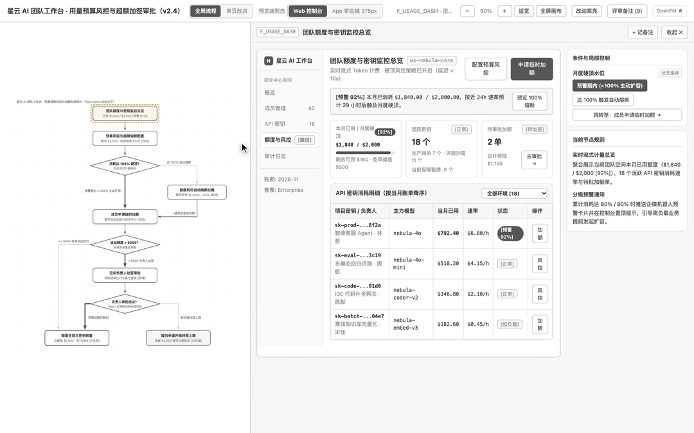
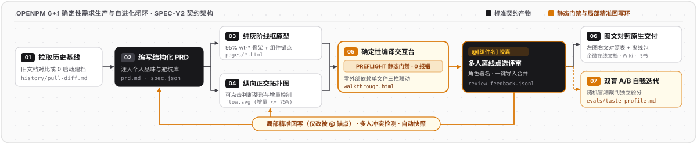

<div align="center">


<br/>

<p>
  <a href="./README.md">English</a> | <strong>简体中文</strong>
</p>

<p>
  <a href="./LICENSE"></a>
  <a href="./scripts"></a>
  <a href="#隐私致谢与开源协议"></a>
  <a href="./AGENTS.md"></a>
</p>

<p>
  <a href="https://silassolivagus.github.io/OpenPM/"><strong>在线体验门户</strong></a> ·
  <a href="https://silassolivagus.github.io/OpenPM/projects/ai-workspace-guardrails-zh/walkthrough.html"><strong>中文在线样板</strong></a> ·
  <a href="https://silassolivagus.github.io/OpenPM/projects/ai-workspace-guardrails/walkthrough.html"><strong>英文在线样板</strong></a> ·
  <a href="https://silassolivagus.github.io/OpenPM/guide.html"><strong>新手速查手册</strong></a> ·
  <a href="https://silassolivagus.github.io/OpenPM/sponsor.html"><strong>赞赏支持</strong></a>
</p>

</div>

> **一句话说清 OpenPM**：给产品经理用的本地工具。把写需求、画流程图、做原型和评审串起来，改一处全部同步，定稿直接出图文文档，不用来回折腾。
>
> **项目缘起与共同作者**：源于 **[@roxorlt](https://github.com/roxorlt)** 的交互设想及其开源项目 **[roxorlt/UEmaster](https://github.com/roxorlt/UEmaster)**，由 **[@SilasSolivagus](https://github.com/SilasSolivagus)** 与 **[@roxorlt](https://github.com/roxorlt)** 共同维护开发。

<p align="center">
  
</p>

---

## 为什么直接拿 AI 写需求像「抽盲盒」，而 OpenPM 能当日常主力工具用？

别人用 AI 做产品往往像「抽盲盒」，每次生成全看运气；OpenPM 干的事情很简单：给 AI 建了一套**不用配环境、自带质检员、能多人批注、还会自己记错题进化的标准化工厂**。

1. **让 AI 只管「填表」，别让 AI 直接「写网页」**
   以前让 AI 直接写交互原型，写着写着就乱套、改一处崩一片。现在让 AI 只负责产出规规矩矩的清单和页面碎片，剩下的组装、联动和交互全部交给固定程序一键生成。稳得像流水线，而且手机端/电脑端共用一套底稿，改一处同步生效。
2. **不用折腾环境，拿来就能直接跑**
   很多开源工具动不动要装一堆依赖包、浏览器驱动、Word 插件，产品经理光配环境就劝退了。OpenPM 只用电脑自带的基础 Python，就能直接遥控 Chrome 自动截图、直接拼出 Word 文档，零额外安装，不折腾人。
3. **给 AI 配了个「铁面质检员」，不合格直接打回**
   以前靠 Prompt 苦口婆心叮嘱 AI「别乱配色、流程图别画歪、别漏掉分支」，AI 经常转头就忘。现在把规矩写成自动安检机：但凡多涂了一点花哨颜色、连线没对准框、或者漏写状态，程序直接拦下逼着 AI 改对，不用人肉兜底。
4. **不用搭服务器，发一个文件就能多人「指哪打哪」评审，还能抓出意见冲突**
   把生成的单个网页（`walkthrough.html`）丢进微信或企微群，研发、测试点一下具体的按钮就能写批注；大家把意见导出来一汇总，系统会自动检查「前端和测试是不是对同一个按钮意见打架了」，标橙提醒 PM 拍板；拍完板 AI 只精准改那一小块，绝不把整篇文档重写一遍。
5. **AI 会自己记「错题本」，升级前还要「蒙眼盲测」考试**
   每次定稿，系统会自动算一下你把 AI 的初稿改了多少（返工率），并默默记下你的修改习惯和踩过的坑。攒够几条就升级一次规则；而且升级不是拍脑袋，而是把新旧两版结果匿名打乱，让独立裁判「蒙眼打分」，真比原来好用才上线。
6. **自动「图文配对」，严防泄密，绝不「假装成功」**
   导出 Wiki 或 Word 时，自动把零散的需求文字精准贴到对应的截图旁边（左图右文、支持右栏内嵌同页多状态 `原型 | 说明` 子表、拉推还带逐字高亮的差异报告，不重复啰嗦）；日志里一旦出现公司密钥或 Token 自动打码防泄密；万一截图失败或没传上平台，直接说实话报错，绝不糊弄你说「已推送成功」。

---

## 安装与日常用法

### 1. 复制一句话发给你的 AI 编程客户端

打开 **Claude Code、Cursor、Codex、Antigravity、WorkBuddy 或 `dsh`**，直接发送：

```text
帮我安装并启动 https://github.com/SilasSolivagus/OpenPM
```

Agent 会拉下仓库、问你 5 个简短的项目背景问题（不想填可直接跳过，默认走黑白灰本地模式）、帮你把平台密钥写进 `.gitignore` 忽略的 `.env.local`，然后直接问你要做什么需求。

### 2. 日常最常用的 4 句话

| 场景 | 直接对 Agent 说 | 后台实际执行的事 |
| :--- | :--- | :--- |
| **1. 做新需求** | *“我要做一个【大文件断点续传】需求，先帮我出 PRD 和可点击原型”* | 读取历史错题与偏好，写 `prd.md`、画纯灰阶 `pages/*.html` 和纵向正交 `flow.svg`，过完质检后输出单文件 `walkthrough.html` |
| **2. 改线上老功能** | *“这是线上旧文档链接，这期增加【月度额度超 ¥35,000 需 VP 审批】”* | 先拉取旧文档生成逐字高亮的 `history/pull-diff-report.html`，保留老页面为黑白灰，只把本期新增分支和改动控件标成 `#D97706` 琥珀橙 |
| **3. 合并多人评审意见** | *“把前端、后端和测试发来的 `.jsonl` 批注合并检查下冲突，确认后改稿”* | 检查同一 `@[组件名]` 下有没有打架的意见，有冲突先列给你拍板，确认后只改对应段落与页面片段，并存一份 `versions/vN` 快照 |
| **4. 定稿导出 / 推上 Wiki** | *“这版定稿了，帮我导出左图右文方案推到企业微信 / Confluence / 飞书”* | 自动截全多端与多状态纯灰阶图，组装 `.docx` / Confluence XML / `wiki-page.html`（本地同步生成 `push-diff-report.html` 核验改动），推送到目标平台 |

### 旧工作区升级

之前装过旧版的目录，在会话里发这一句即可更新脚本（不会动你的 `.env.local` 和 `projects/` 里的现有需求）：

```text
帮我从 https://github.com/SilasSolivagus/OpenPM 运行 python3 scripts/upgrade_openpm.py 升级最新脚本（保留我的 .env.local 和 projects/ 现有目录），并重新校验当前项目的 walkthrough.html
```

---

## 生成的 `walkthrough.html` 长什么样

编译出来的 `walkthrough.html` 只有一个本地网页文件，不连外网、不用装插件，双击用浏览器就能打开。

### 1. 流程图、可点击原型、需求说明同屏联动
点左边任意流程节点，中间切换对应可点击页面（支持一键切 **Web 宽屏 / App 375px** 及页内多状态），右边同步显示该页说明；拨动顶栏条件开关可以现场走通「是 / 否」分支，打开「改动高亮」一眼看清这期改了哪：


### 2. 规则卡片连线直指具体按钮
切到顶栏「单页改点」视图，点右边任意一条改点卡片，画布会自动跳到对应页面，拉出一根连线直接指到具体的输入框、弹窗或按钮上，开会不用再喊“看右上角第二个按钮”：


### 3. 点按钮挂 `@[组件名]` 批注，合并时自动抓冲突
点右上角「+ 记备注」填上名字（比如 `前端-王工`），再点原型上的任意控件，就会自动带出 `@[组件名]` 标签并记下当前分支状态。大家各自导出 `.jsonl` 汇总，同组件意见打架会自动拦住请 PM 定夺：


---

## 6+1 流水线步骤

<p align="center">
  
</p>

1. **`01-pull-wiki`（拉取基线与对比）**：拉取线上旧文档至 `history/prd-remote.md`，同时产出 `pull-diff.md` 和带行内字符级高亮的 `history/pull-diff-report.html`。
2. **`02-draft-prd`（写 PRD / 局部改稿）**：先读 `evals/taste-profile.md` 里的错题本与改稿习惯，编写或局部修改 `prd.md`。
3. **`03-prd-to-wireframe-prototype`（画纯灰阶线框图）**：按 `wt-*` 黑白灰样式和点分小写 `data-comp-id` 锚点生成 `pages/*.html` 页面碎片。
4. **`04-flow-canvas`（画纵向正交流程图）**：生成自上而下（`TD`）水平/垂直正交折线的 `flow.svg`，带可切换 `D_*` 判断节点，且本期增量节点占比不超过 `75%`。
5. **`05-flow-walkthrough`（质检与组装网页）**：先跑 `scripts/preflight_check.py` 自动安检，合格后再由 `scripts/build_walkthrough.py` 拼出单文件 `walkthrough.html`。
6. **`06-push-wiki`（图文配对导出与推送）**：自动截取基页面、多端变体与同页多状态纯灰阶图，生成三列「序号 | 页面 | 需求说明（支持内嵌多状态 `原型 | 说明` 子表）」的 `.docx`、`confluence-storage.xml` 与 `wiki-page.html`，并在本地生成 `wiki-export/push-diff-report.html`。
7. **`07-iterate-skills`（错题整理与蒙眼盲测）**：统计初稿到定稿的返工率，攒够改稿记录后把新旧两版匿名打乱（`candidate_first` / `baseline_first`）做盲测打分，真比原来好才写进 `evals/taste-profile.md`。

---

<details>
<summary><strong>Agent 自动安装与启动说明（供 AI Agent 读取，人类用户不用看）</strong></summary>

<br/>

> **写给读取本仓库的 AI Agent（`Claude Code`、`Cursor`、`Codex`、`Antigravity`、`WorkBuddy`、`dsh`）**：当用户发来本仓库地址或让你安装/启动 `OpenPM` 时，请按以下三步安静完成初始化（完整规则见 [AGENTS.md](./AGENTS.md)）。**不要输出安装日志、PID、端口号、文件大小，也不要自动启动示例项目的本地 HTTP 服务**：
>
> 1. **克隆与环境准备**：
>    - 克隆仓库；若根目录没有 `.env.local`，从 `templates/.env.local.example` 复制一份；若在 `dsh` 环境，将 `skills/01-*` ~ `07-*` 软链到 `~/.dsh/skills/`。
>    - 跟随用户对话语言：中文对话产出中文文档（`spec.json` 默认 `"lang": "zh"`）；英文对话产出英文文档并设 `"lang": "en"`。
> 2. **两步问答配置（不要跳步，不要让 PM 自己手改 `.env.local`）**：
>    - **第 1 步（`AskUserQuestion` 问 5 个基础问题）**：一次问清：① 公司/团队、② 业务领域、③ 产品名与目标用户、④ 覆盖端形态（`App 375px` / `PC Web` / `管理后台 web-admin` / `小程序` / `多端`）、⑤ 参考截图与文档平台（`wecom` 企业微信 / `confluence` / `feishu` 飞书 / `local-obsidian` 纯本地）。
>    - **第 2 步（代填 `.env.local`）**：
>      - 选 `wecom`：询问 `WECOM_BOT_ID` + `WECOM_BOT_SECRET`（或群 `Webhook`）及可选目录 `WECOM_FOLDER_ID`，代写入 `.env.local`；
>      - 选 `confluence`：询问 `WIKI_BASE_URL`、`CONFLUENCE_PAT` 及目标空间/父页面链接，代写入 `.env.local`；
>      - 选 `feishu`：询问 `FEISHU_APP_ID`、`FEISHU_APP_SECRET` 及可选目录链接，代写入 `.env.local`；
>      - 若 PM 跳过暂不填，直接启用 `local-obsidian` 本地离线模式与默认黑白灰 `project-context.md`，不要卡流程。
>    - **远端上传边界**：`project-context.md`、`spec.json`、裸 `prd.md`、`pages/*.html` 以及 `*-diff-report.html` 仅供本机使用，严禁把这些本地工程文件传到企微微盘、飞书目录或 Confluence 附件里。
> 3. **简短收尾（控制在 10 行以内）**：
>    - 两句话说清本地文件放哪（`projects/<产品名>/` 可直接用 Obsidian 打开，密钥只存本机 `.env.local`，无任何后台统计上报）以及什么时候上传远端（只在确认定稿执行 `06-push-wiki` 时）；
>    - 发给 PM **[guide.html](./guide.html)** 和 **[QUICKSTART.md](./QUICKSTART.md)** 的可点击链接；
>    - 直接问：**“现在一切就绪！请告诉我你要做的第一个需求是什么？（如果是改线上已有功能，发我旧文档或链接，我从 `01 拉取对比` 开始；如果是全新功能，直接说你的想法，我从 `02 写 PRD` 开始。）”**

</details>

<details>
<summary><strong>目录结构与命令行参考（默认由 Agent 自动调用）</strong></summary>

<br/>

### 主要目录
- `AGENTS.md` / `CLAUDE.md` / `WORKBUDDY.md` / `.cursorrules`：各 AI 客户端统一入口说明与灰阶线框规范
- `skills/01-*` ~ `07-*`：从拉取对比、写 PRD、画线框、画流程图、编译工作台到推送 Wiki 的分步技能说明
- `specs/`：`spec-v2` JSON Schema、组件锚点规范、正交流程图规范与静态检查项
- `adapters/`：企业微信（`wecom`）、Confluence（`confluence`）、飞书（`feishu`）与本地 Obsidian（`local-obsidian`）适配说明
- `projects/`：按需求隔离的工作目录（自带中英文示例项目）

### 常用脚本（仅用电脑自带的基础 Python 3）
```bash
# 1. 自动质检（编译前查 spec.json，编译后查 walkthrough.html）
python3 scripts/preflight_check.py projects/ai-workspace-guardrails-zh/spec.json

# 2. 组装单文件三栏交互 HTML
python3 scripts/build_walkthrough.py \
  --spec projects/ai-workspace-guardrails-zh/spec.json \
  --svg projects/ai-workspace-guardrails-zh/flow.svg \
  --pages-dir projects/ai-workspace-guardrails-zh/pages \
  --out projects/ai-workspace-guardrails-zh/walkthrough.html

python3 scripts/preflight_check.py projects/ai-workspace-guardrails-zh/walkthrough.html

# 3. 拉取远端基线或推送左图右文方案（自动生成可视化 HTML Diff 报告）
python3 scripts/wiki_sync.py pull projects/ai-workspace-guardrails-zh
python3 scripts/wiki_sync.py push projects/ai-workspace-guardrails-zh

# 4. 批量汇总整个 projects/ 目录的同步差异报告
python3 scripts/wiki_diff_report.py projects/ --batch -o projects/_diff-report.html

# 5. 版本快照、对比与回滚
python3 scripts/version_manager.py snapshot projects/ai-workspace-guardrails-zh --note "评审后修改"
python3 scripts/version_manager.py diff projects/ai-workspace-guardrails-zh v1 v2
python3 scripts/version_manager.py rollback projects/ai-workspace-guardrails-zh v1

# 6. 旧工作区保留数据升级脚本
python3 scripts/upgrade_openpm.py
```

</details>

---

## 赞赏支持

OpenPM 采用 MIT 协议开源，无外部依赖，也没有任何后台数据上报。如果它帮你省下了画原型、开会扯皮和贴表格的时间，欢迎请作者喝杯冰美式：

<div align="center">
  <a href="https://silassolivagus.github.io/OpenPM/sponsor.html">
    
  </a>
</div>

---

## 隐私、致谢与开源协议

- **共同作者与致谢**：OpenPM 源于 **[@roxorlt](https://github.com/roxorlt)** 的设想与开源项目 **[roxorlt/UEmaster](https://github.com/roxorlt/UEmaster)**（将正交流程图与线框原型放在同一视图联动走查）。在此基础上，**[@SilasSolivagus](https://github.com/SilasSolivagus)** 与 **[@roxorlt](https://github.com/roxorlt)** 一起补齐了 `spec-v2` 编译器、黑白灰底图 + `#D97706` 琥珀橙改点标记、多人 `@[组件名]` 批注冲突拦截、多平台左图右文导出（含同页多状态子表）、行内高亮 Diff 报告与蒙眼盲测规则升级脚本。
- **本地运行，无后台上报**：所有脚本只用基础 Python 3 在本机执行，日志遇到密钥自动打码，不接任何统计埋点或第三方中转服务；未公开的需求文件只在你明确执行推送时才会发往你自己的文档平台。觉得顺手的话，欢迎在右上角点个 **Star**。
- **开源协议**：[MIT License](./LICENSE)（Copyright © 2026 SilasSolivagus, roxorlt & Contributors）。
